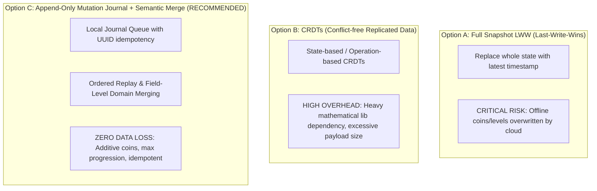
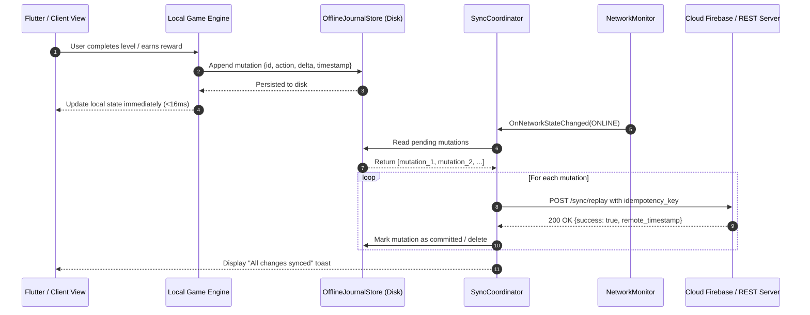
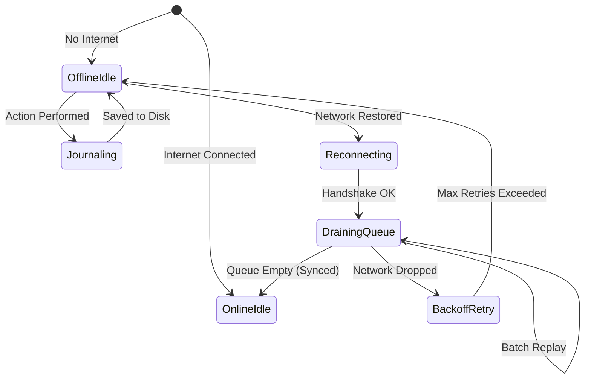

# SpecKit Comprehensive Feature Assessment: offline-mode

**Feature Title:** Offline-First Architecture & Resilient Cloud Auto-Sync  
**Slug:** `offline-mode`  
**Assessment Date:** 2026-11-14  
**Status:** APPROVED (DECIDED: GO)  

---

## 1. Intake Phase (`/speckit-assess-intake`)

### 1.1. Problem Statement
Users on mobile and edge devices frequently experience intermittent connectivity drops, airplane mode, subway commutes, or rural dead zones. In existing cloud-dependent workflows:
1. Actions taken without active internet fail immediately with network error dialogs, blocking gameplay or productivity.
2. Progress made while playing in "Guest / Offline" mode is either discarded or at risk of overwriting newer cloud state upon reconnection.
3. Users lack clear visual trust indicators confirming whether their data is safely preserved locally or queued for synchronization.

### 1.2. Value Proposition & Business Impact
- **Frictionless Play & Work:** Zero blocked user interactions regardless of network availability. The app responds instantaneously (<16ms) to user input.
- **100% Data Preservation:** All actions, level completions, currency gains, and media modifications are committed immediately to local persistent storage before network dispatch.
- **Trust & Transparency:** Users see non-intrusive status indicators confirming that their offline work is safe and automatically reconciled when their connection is restored.

### 1.3. Scope & Boundary
- **In Scope:**
  - Connectivity monitoring with heartbeat and debounce against network flapping.
  - Persistent, append-only offline mutation journal on disk (`SharedPreferences` / SQLite / local disk).
  - Idempotent transaction replay with deduplication keys (`uuid`).
  - Semantic two-way conflict resolution (additive currency merge, monotonic progression max, inventory set union).
  - UI status indicators (Offline Pill, Sync in Progress spinner, Sync Complete checkmark).
- **Out of Scope:**
  - Real-time multiplayer matches while offline (real-time competitive play inherently requires a live socket server). Local 2-player Pass & Play remains 100% offline.

---

## 2. Research Phase (`/speckit-assess-research`)

### 2.1. Technical Landscape & Codebase Audit
| Project | Current Storage | Network Layer | Offline Capability | Gaps Identified |
|---|---|---|---|---|
| **bida_game** | `SharedPreferences` (JSON) | Firebase Realtime DB + WebSocket | "Guest mode" ignores cloud; Cloud login wipes local guest progress | No sync journal; guest progress lost on login; no auto-reconnect sync queue. |
| **Blockblast-Passengerloop** | `SharedPreferences` | Pure offline currently | 100% offline capable | Ready for cloud backup integration when online. |
| **photo-organizer** | SQLite (`node:sqlite`) + Local disk | Express REST API | Local-first by default | Ready for multi-device sync endpoints. |

### 2.2. Architectural Options Evaluated



- **Option A (Full Snapshot Last-Write-Wins):** Rejected due to high risk of data destruction. If a user earns 500 coins offline, and cloud syncs an older balance, those coins are permanently lost.
- **Option B (CRDT Engine):** Overkill for casual game and organizer models; adds unnecessary runtime footprint.
- **Option C (Append-Only Mutation Journal + Semantic Domain Merge):** **Selected.** Lightweight, deterministic, 100% testable, and guarantees zero loss of user achievements.

---

## 3. Definition Phase (`/speckit-assess-define`)

### 3.1. Functional Requirements (FR)
- **FR-1 (Connection Monitoring):** Continuously monitor network reachability with a 3-second debounce to prevent flapping thrash.
- **FR-2 (Local Journaling):** Every state-altering action writes an atomic mutation entry to the persistent local queue with a unique UUID before attempting network I/O.
- **FR-3 (Auto-Drain & Replay):** When connectivity transitions from offline to online, the sync engine drains the mutation queue in FIFO order with exponential backoff on retryable HTTP errors.
- **FR-4 (Semantic Merge Rules):**
  - **Progression / Level Stars:** $\text{Level}_{\text{final}} = \max(\text{Level}_{\text{local}}, \text{Level}_{\text{remote}})$.
  - **Currencies (Gold / Gems):** Cumulative offline deltas are summed: $\text{Balance}_{\text{final}} = \text{Balance}_{\text{cloud}} + \sum \Delta_{\text{offline}}$.
  - **Inventory / Unlocks (Cues, Skins, Tables):** Mathematical set union: $\text{Items}_{\text{final}} = \text{Items}_{\text{local}} \cup \text{Items}_{\text{remote}}$.
- **FR-5 (Idempotency):** Each mutation carries an idempotency key; the server rejects or skips duplicate mutations if re-sent during dropped acknowledgments.
- **FR-6 (Visual Feedback):** Provide a subtle, non-intrusive status pill in the top HUD indicating `Offline Mode (Saved)`, `Syncing...`, and `Synced`.

### 3.2. User Stories & Acceptance Criteria

#### US-1: Offline Level Completion
- **Given** the player is in an area with no internet,
- **When** they complete Level 15 with 3 stars and earn 150 gold coins,
- **Then** the game immediately unlocks Level 16, awards the coins locally, writes `UNLOCK_LEVEL(15, 3)` and `ADD_COINS(150)` to the local journal, and displays the "Saved Offline" indicator.

#### US-2: Seamless Reconnection Sync
- **Given** the player has 3 queued mutations in their local journal,
- **When** cellular connectivity is restored,
- **Then** the game automatically initiates background synchronization, drains all 3 mutations successfully, updates the cloud database, and updates the HUD indicator to "All Changes Synced".

#### US-3: Multi-Device Concurrent Merge
- **Given** Device A completed Level 12 offline while Device B completed Level 14 online,
- **When** Device A reconnects to the network,
- **Then** the merge algorithm sets the player's level to 14 (max of 12 and 14), adds Device A's earned coins to the account balance, and preserves all unlocked skins without overwriting.

---

## 4. Shaping Phase (`/speckit-assess-shape`)

### 4.1. System Architecture Diagram



### 4.2. Data Model: `SyncMutation`

```dart
class SyncMutation {
  final String id;              // UUID v4
  final String entity;          // 'progression', 'currency', 'inventory'
  final String action;          // 'ADD_COINS', 'UNLOCK_LEVEL', 'EQUIP_ITEM'
  final Map<String, dynamic> payload; // { 'amount': 150, 'level': 12, 'stars': 3 }
  final DateTime createdAt;
  int retryCount;
  bool isCommitted;

  SyncMutation({
    required this.id,
    required this.entity,
    required this.action,
    required this.payload,
    required this.createdAt,
    this.retryCount = 0,
    this.isCommitted = false,
  });

  Map<String, dynamic> toJson() => {
    'id': id,
    'entity': entity,
    'action': action,
    'payload': payload,
    'createdAt': createdAt.toIso8601String(),
    'retryCount': retryCount,
    'isCommitted': isCommitted,
  };
}
```

### 4.3. Finite State Machine for `SyncCoordinator`



---

## 5. Decision Phase (`/speckit-assess-decide`)

### 5.1. Evaluation Scorecard
| Criteria | Weight | Option A (LWW) | Option B (CRDT) | Option C (Mutation Journal) |
|---|:---:|:---:|:---:|:---:|
| **Zero Data Loss** | 30% | 2/10 | 10/10 | 10/10 |
| **Simplicity & Maintainability** | 25% | 9/10 | 3/10 | 9/10 |
| **Mobile & Battery Efficiency** | 20% | 8/10 | 4/10 | 9/10 |
| **Speed to Implement & Test** | 15% | 9/10 | 3/10 | 9/10 |
| **UX Transparency** | 10% | 4/10 | 7/10 | 10/10 |
| **Weighted Total** | **100%** | **6.0 / 10** | **5.4 / 10** | **9.4 / 10** |

### 5.2. Final Decision Gate: **GO (APPROVED)**
- **Selected Strategy:** **Option C — Append-Only Offline Mutation Journal with Semantic Domain Merging**.
- **Key Invariants:**
  1. No state-altering user interaction shall ever be blocked by network unavailability.
  2. Currency mutations are additive deltas, never absolute balance overwrites.
  3. Progression levels and achievements use monotonic ceiling (`max`) logic.
  4. The local journal is persisted to disk before memory garbage collection or process sleep.

### 5.3. Implementation Roadmap
1. **Milestone 1:** Implement `OfflineMutationQueue` service with disk persistence and unit tests (100% test coverage).
2. **Milestone 2:** Implement `ConnectivityWatcher` and `SyncCoordinator` with exponential backoff and replay deduplication.
3. **Milestone 3:** Connect `ProgressionService` and `AuthService` to automatically drain offline guest mutations into user accounts upon sign-in.
4. **Milestone 4:** Add the subtle HUD Sync Status Pill widget across game headers.

