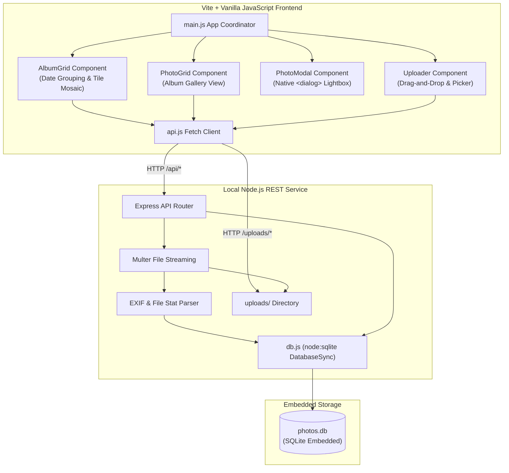

# SpecKit Technical Plan: Photo Organizer

## 1. System Architecture



---

## 2. Technology Choices & Justification

| Layer | Technology | Justification |
|---|---|---|
| **Bundler & Dev Server** | Vite 6 | Instant HMR, zero-config ES module bundling, clean vanilla JS development. |
| **Frontend Framework** | Pure Vanilla JS (ES Modules) | Direct DOM manipulation, ultra-fast load time, 0 runtime framework overhead. |
| **Styling** | Modern CSS (Grid, Flexbox, Variables, `@container`) | Native support, dark/light theme, high-DPI tile mosaics, mobile-first responsive. |
| **Modal / Lightbox** | Semantic `<dialog>` | Native accessibility, focus trapping, `closedby="any"` light-dismiss with JS fallback. |
| **Backend Server** | Node.js Express 4.x | Minimalistic, robust stream handling for file uploads, standard JSON API. |
| **Database** | SQLite via `node:sqlite` | Built directly into Node 22 (`DatabaseSync`), zero C++ compilation dependencies, bulletproof performance on Windows. |
| **File Storage** | Local filesystem (`uploads/`) | Preserves full original image fidelity locally without cloud costs or remote leakage. |
| **Testing** | `node:test` + `node:assert` | Built-in test runner, zero test framework dependencies, sub-second execution. |

---

## 3. Directory & File Plan

```
photo-organizer/
├── .specify/
│   ├── constitution.md
│   ├── spec.md
│   ├── plan.md
│   └── tasks.md
├── server/
│   ├── db.js             # SQLite DatabaseSync connection, migrations, and queries
│   ├── server.js         # Express app, upload endpoints, API routes, static serving
│   └── seed.js           # Seeds sample test images for instant first-run experience
├── src/
│   ├── components/
│   │   ├── AlbumGrid.js  # Renders date-grouped album cards with tile previews
│   │   ├── PhotoGrid.js  # Renders full photo gallery for a selected album
│   │   ├── PhotoModal.js # Native <dialog> image viewer with metadata drawer
│   │   ├── Uploader.js   # Drag-and-drop file upload zone & progress bar
│   │   └── Header.js     # Top bar with view switcher, search bar, theme toggle
│   ├── api.js            # Frontend REST API client
│   ├── main.js           # Client orchestration and state management
│   └── style.css         # Modern, mobile-first CSS styles
├── tests/
│   ├── db.test.js        # Unit tests for SQLite operations & date aggregation
│   └── api.test.js       # Integration tests for REST endpoints
├── uploads/              # Local storage folder for uploaded photos
├── index.html            # Vite HTML entry point
├── package.json          # Dependencies & scripts
└── vite.config.js        # Vite config with proxy to backend server
```

---

## 4. Database Schema & Indexing Strategy

```sql
CREATE TABLE IF NOT EXISTS albums (
  id INTEGER PRIMARY KEY AUTOINCREMENT,
  date_key TEXT UNIQUE NOT NULL,      -- 'YYYY-MM-DD'
  title TEXT NOT NULL,                -- e.g. 'November 14, 2026'
  created_at TEXT DEFAULT (datetime('now'))
);

CREATE TABLE IF NOT EXISTS photos (
  id INTEGER PRIMARY KEY AUTOINCREMENT,
  album_id INTEGER NOT NULL,
  filename TEXT NOT NULL,
  original_name TEXT NOT NULL,
  mime_type TEXT NOT NULL,
  size_bytes INTEGER NOT NULL,
  width INTEGER DEFAULT 0,
  height INTEGER DEFAULT 0,
  date_taken TEXT NOT NULL,            -- ISO string: 'YYYY-MM-DDTHH:MM:SS.sssZ'
  camera_model TEXT DEFAULT '',
  caption TEXT DEFAULT '',
  created_at TEXT DEFAULT (datetime('now')),
  FOREIGN KEY (album_id) REFERENCES albums(id) ON DELETE CASCADE
);

CREATE INDEX IF NOT EXISTS idx_photos_album_id ON photos(album_id);
CREATE INDEX IF NOT EXISTS idx_photos_date_taken ON photos(date_taken DESC);
CREATE INDEX IF NOT EXISTS idx_albums_date_key ON albums(date_key DESC);
```

---

## 5. Tile Preview Logic

Each album card in the date catalog renders a dynamic tile preview mosaic:
1. **1 Photo:** 1 large tile taking 100% width and height.
2. **2 Photos:** 2 equal vertical columns (`50% / 50%`).
3. **3 Photos:** Left column has 1 large tile (`60%` width), right column has 2 stacked tiles (`40%` width, `50%` height each).
4. **4+ Photos:** 2x2 symmetrical grid. If the album has $> 4$ photos, the 4th tile shows an overlay badge with `+N` indicating remaining photos.
This creates a visually engaging, modern album cover preview similar to Apple Photos and Google Photos.

